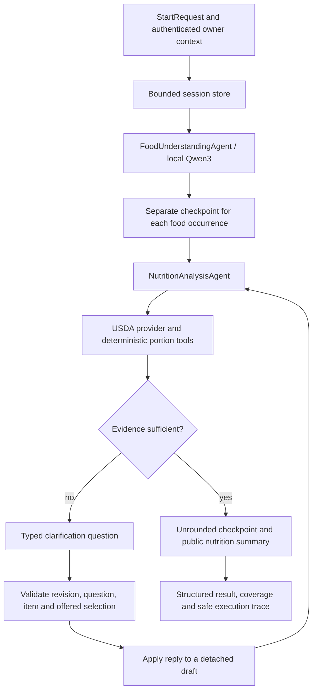

# Milestone 3: Agentic AI orchestration

Milestone 3 connects the existing food-understanding agent to verified nutrition tools. The orchestrator is a small Python state machine: it remembers which work succeeded, asks for missing evidence and resumes the affected item. It does not ask a language model to choose nutrient values or make serving conversions.

## Architecture and six implementation stages



1. **Contracts and configuration:** versioned Pydantic start, reply, retry and session contracts; bounded settings.
2. **Session storage:** unpredictable IDs, ownership checks, fixed expiry, storage quotas and atomic transactions.
3. **Reusable nutrition steps:** an additive `analyze_item()` method and summaries that no longer mutate calculation inputs.
4. **Orchestration engine:** extraction once, per-item checkpoints, normalized lookup caching and targeted retries.
5. **Clarification and observability:** validated actions, explicit evidence, safe errors and bounded allowlisted traces.
6. **Validation and demonstration:** deterministic offline tests, scripted multi-turn CLI examples and separately recorded actual Qwen3 inference.

No backend, frontend or root configuration changes are needed. Existing M1/M2 schemas and CLI entry points remain intact. Existing HTTP client defaults remain intact; orchestration opts into attempt accounting and disables USDA raw-response caching.

## What a session remembers

The private session stores its server-supplied owner, original meal text and provider mode. Its original M1 extraction is retained unchanged. Each food occurrence has its own opaque item ID, original index, effective food description, explicit reply evidence, successful normalized search/record checkpoints and an **unrounded** `NutritionItemResult`.

The public `SessionResponse` contains extraction, the existing M2 `NutritionResult`, typed pending questions, clarification evidence, usage counters and safe trace events. Decimal nutrition values serialize as strings, following M2. Private owner information and transport caches are absent from this response. Use the top-level `SessionResponse.questions` for current UI prompts; questions inside the immutable original extraction describe the first turn only.

| Session status | Meaning |
| --- | --- |
| `awaiting_clarification` | At least one item needs user evidence. |
| `waiting_for_retry` | Extraction or a lookup failed; existing successes remain available. Other pending questions can still be answered. |
| `completed` | No pending workflow actions remain. Check `nutrition.status` and coverage: this can still be partial if a food was left unresolved or nutrients are absent. |
| `failed` | The original input is invalid. Start a new session with corrected input. |
| `limit_reached` | A resource limit stopped work. Read the retained results and start a new session if needed. |

Execution is synchronous. Expired, closed, unknown and differently owned sessions all return `session_not_found`; they are not retained as public expired/closed records. TTL is checked before budgeted operations and before committing. An in-flight HTTP request finishes or times out; it cannot resurrect an expired session. Expired entries are purged on subsequent store access.

## Clarification rules and atomicity

`respond()` requires `expected_revision`, `request_id`, `question_id`, `item_id` and one discriminated action. A successful submission advances the revision. Every accepted request ID is retained within the bounded turn history. A duplicate is rejected rather than replayed.

* `quantity`: explicit positive quantity and supported unit. Its Decimal value is preserved separately from M1's float field for calculation.
* `measured_grams`: explicit total edible grams for that item, not a guessed density or database portion weight.
* `select_food`: an FDC ID offered for the current question, checked against the food and the returned record's identity.
* `select_portion`: an offered USDA portion ID, with the correct unit and no contradictory size/form qualifiers.
* `preparation`: an explicit user-supplied preparation. Matching is repeated for this item; its old source choice is discarded.
* `refine_food`: an explicit replacement description sent through food understanding for **this item only**. It must yield exactly one food. There is no automatic recipe decomposition.
* `leave_unresolved`: stop asking about this food while retaining it in coverage and unknown meal totals.

Stale revisions/questions, invalid choices, duplicate requests, extra JSON fields, cross-item and cross-session replies are rejected before tools run. They leave stored results, revision, budgets and traces unchanged. The store uses a detached copy and a lock, so two concurrent replies to one revision cannot both commit.

A refinement that reaches the model but fails is different from an invalid selection: its actual tool/HTTP costs and accepted request ID are retained. The previous food, extraction and nutrition are preserved, the response includes a safe error and the question remains answerable. This prevents unsuccessful model calls from bypassing retry limits.

Portion-only replies reuse normalized search/record data. Completed unrelated items do not call matching, lookup or calculation again. A failed detail fetch retries the fetch while reusing the successful search. Replies to structured questions do not invoke Ollama. Only an explicitly requested refinement or recovery from a failed initial extraction invokes it again.

Summaries deep-copy item checkpoints before rounding display values to four decimal places. Repeated summaries and later clarifications therefore do not round stored intermediate values. Missing nutrients remain `None`, and unresolved items remain in the total item count. Existing M1 float precision is unchanged; clarification amounts support up to 12 decimal places and 20 significant digits within the documented magnitude limits.

## Resource bounds and trace privacy

Settings use process environment variables named `NUTRIAI_ORCH_<FIELD_IN_UPPERCASE>`; for example `NUTRIAI_ORCH_MAX_SESSIONS`. They do not read backend configuration or credentials.

| Setting | Default | Hard range |
| --- | ---: | ---: |
| `max_sessions` | 20 | 1-100 |
| `ttl_seconds` | 1800 | 1-86400 |
| `max_session_bytes` | 2097152 | 4096-4194304 |
| `max_store_bytes` | 16777216 | 4096-67108864 |
| `max_request_bytes` | 16384 | 256-32768 |
| `max_reply_bytes` | 4096 | 256-8192 |
| `max_turns` | 10 | 1-30 |
| `max_steps` | 200 | 1-1000 |
| `max_tool_calls` | 100 | 1-300 |
| `max_http_attempts` | 100 | 1-300 |
| `max_trace_events` | 500 | 4-1000 |

M1 already limits meal text to 4000 characters and 40 foods. M3 restricts normalized searches to 50 candidates and normalized food details to 128 KiB / 200 portions. HTTP response byte limits and client timeouts still apply. A quantity reply is at most 1,000,000 units; total measured edible grams are at most 1,000,000,000. Unsupported conversions remain unresolved regardless of quantity.

One logical extraction or source lookup consumes a tool call; **each real HTTP attempt**, including client retries, consumes the separate HTTP budget. Existing Ollama schema retries and USDA retries remain bounded by their existing settings. There is no additional automatic orchestrator retry loop. Trusted injected test/custom transports must install the provided attempt observer if they make HTTP requests.

The store accounts for serialized session/checkpoint bytes, including cached normalized data. It reserves 1024 bytes per actionable session for terminal error metadata. On a storage overflow it keeps the last committed nutrition, records spent budgets, clears private caches if necessary and marks the session terminal. Original results are not overwritten with an oversized draft. A start-time storage overflow returns the retained terminal session when reservation succeeded; an overflow during an existing session raises a stable error, after which `get()` retrieves its terminal state.

These limits bound application state and response buffers; they are not an operating-system RSS quota. Python object overhead, temporary bounded serialization/deep copies, imported libraries and the separate Ollama model process consume additional memory. Completed sessions count toward capacity until closed or expired. A production service also needs request rate limiting and process/container resource limits.

Traces contain only sequence, revision, stage, event, item ID, allowlisted reason codes and optional USDA/calculation identifiers and Decimal factors. They contain **no prompts, meal text, raw HTTP bodies, exception strings, URLs with credentials or model reasoning**. A final trace slot is reserved for a limit event. Storage pressure may discard older trace data while retaining an explicit terminal error/event and the previous nutrition results.

## Python integration contract

Run from the repository root with the existing environment:

```python
from agentic_ai.orchestration import AgentOrchestrator

service = AgentOrchestrator()
state = service.start(
    {"text": "I ate 2 rotis and cooked white rice.", "provider": "snapshot"},
    owner="authenticated-user-id",
)
# Display state.questions and its offered choices. Construct the action from the
# user's actual answer; this example is an explicit small-roti confirmation.
question = next(q for q in state.questions if q.item_index == 0)
state = service.respond(state.session_id, {
    "expected_revision": state.revision,
    "request_id": "client-generated-unique-request-id",
    "question_id": question.question_id,
    "item_id": question.item_id,
    "action": {"kind": "select_portion", "portion_id": "299422"},
}, owner="authenticated-user-id")
```

Use `get(session_id, owner=...)`, `retry(session_id, RetryRequest, owner=...)` and `close(session_id, owner=...)`. A retry can include the opaque ID of one failed item, or omit it to retry all failed items. The existing provider mode is fixed for a session: a live failure never silently switches to snapshots.

For future FastAPI integration, the route should validate these Pydantic DTOs, derive owner identity from authentication and pass it as the separate service argument. Never trust an owner submitted in JSON; IDs are not authorization. Translate stable `OrchestrationError.code` values into application HTTP errors. Return `SessionResponse.model_dump(mode="json")`, retaining Decimal strings and nutrition coverage.

`SessionStore` documents the storage protocol. The current implementation uses one in-process lock around transactions, including tool work. It prioritizes correctness for this university milestone: sessions disappear on process restart, concurrent sessions serialize, and multiple workers do not share state. A later adapter needs durable shared storage, atomic revisions, ownership checks, quotas and TTL, plus a worker/thread boundary for these synchronous tool calls. No FastAPI route, authentication system or backend change is included here.

## Demonstrations and testing

```powershell
# Scripted food JSON through the real M1 validation/normalization path;
# authentic offline USDA snapshots; no model or network calls.
.\agentic_ai\.venv\Scripts\python.exe -B -m agentic_ai.orchestration_demo --offline-examples

# Actual locally installed Qwen3. Pending replies are complete JSON objects on stdin.
.\agentic_ai\.venv\Scripts\python.exe -B -m agentic_ai.orchestration_demo --text "I ate 2 rotis and cooked white rice."

# Existing M2 offline CLI remains available.
.\agentic_ai\.venv\Scripts\python.exe -B -m agentic_ai.nutrition_demo --offline-examples

# All M1, M2 and M3 offline regressions. Explicitly disable opt-in live suites.
$env:NUTRIAI_RUN_LIVE_TESTS='0'
$env:NUTRIAI_RUN_NUTRITION_LIVE='0'
$env:NUTRIAI_RUN_USDA_LIVE='0'
.\agentic_ai\.venv\Scripts\python.exe -B -m pytest -c agentic_ai/pytest.ini agentic_ai/tests -q --basetemp=agentic_ai/.test-tmp-m3-review
```

The interactive CLI accepts structured JSON replies/retries; it does not interpret arbitrary conversational replies. The offline CLI demonstrates an Indian meal (rotis and rice), an international meal (apples and banana), an invalid food choice leaving state unchanged and a simulated provider outage followed by recovery. Its output labels scripted extraction and offline source use explicitly. Tests additionally cover missing Ollama, timeouts, authentication/rate-limit errors, source identity conflicts, bounded HTTP retries, request/storage/trace/TTL limits, concurrent replies and exact checkpoint arithmetic. M3 tests block real TCP connections.

The actual Qwen3 run saved under `validation/milestone3/actual-qwen-snapshot-demo.json` is separate from scripted examples. Its first turn used actual local inference; follow-up choices were declared demonstration user replies. USDA data remained offline. The recorded run used one Ollama HTTP attempt. No new live USDA verification was performed for M3.

## Sources and fixture classification

Production snapshot data and its manifest are unchanged from M2. `data/usda/foods.json` is the existing ten-record authentic USDA capture; `data/usda/manifest.json` identifies retrieval time, descriptions, source URLs and checksum. Snapshot loading verifies the manifest and SHA-256 `c3fde77650f6b10f4fa2f568a800464b34808cacb7bef239e40ea38a7c768937`.

| FDC ID | Captured food |
| ---: | --- |
| 173424 | Hard-boiled whole egg |
| 173423 | Fried whole egg |
| 168878 | Cooked enriched long-grain white rice |
| 168877 | Raw enriched long-grain white rice |
| 173944 | Raw banana |
| 171688 | Raw apple with skin |
| 171689 | Raw apple without skin |
| 171265 | Whole milk with added vitamin D |
| 172217 | Whole milk without added vitamins A/D |
| 2707713 | Chappatti/roti reference record |

`ScriptedChat`, declared raw-food inputs, simulated service errors and modified in-memory nutrient/metadata records in tests are **mock fixtures**, not additional USDA captures. The HTTP retry test reuses an authentic saved banana body through a mocked transport and synthetic search envelope; that test is **not live USDA verification**, even though it exercises the live provider's normalization path. Existing M2 synthetic backend per-serving fixtures remain test-only and continue to check against double-scaling.

Snapshot mode needs no credentials. Actual inference needs local Ollama and `qwen3:4b-instruct`. Explicit live mode needs `USDA_API_KEY` plus network access and is subject to USDA rate limits. Missing keys, failures and incomplete search results remain visible; no snapshot fallback or unsupported conversion is substituted.

## Major files and beginner-friendly purpose

| File | Purpose |
| --- | --- |
| `schemas/orchestration.py` | Defines the JSON shapes the UI/backend can exchange with the orchestrator. |
| `orchestration_config.py` | Holds configurable limits with hard upper bounds. |
| `orchestration_errors.py` | Supplies predictable error codes without exposing tool internals. |
| `orchestration/orchestrator.py` | Connects agents, retains per-food work and routes replies/retries. |
| `orchestration/state.py` | Defines private session and unrounded per-food checkpoints. |
| `orchestration/store.py` | Stores bounded sessions and applies updates atomically with owner/TTL checks. |
| `orchestration/clarifications.py` | Offers valid choices and applies explicit user evidence to one item. |
| `orchestration/budget.py` | Stops work before configured action/HTTP limits are exceeded. |
| `orchestration/tracing.py` | Records safe, structured explanations of what ran and why. |
| `orchestration/__init__.py` | Exposes the two main Python entry points. |
| `orchestration_demo.py` | Runs scripted offline scenarios or actual-Qwen interactive sessions. |
| `agents/nutrition_agent.py` (modified) | Adds one-item analysis while preserving the existing meal-level API. |
| `tools/nutrition_calculator.py` (modified) | Rounds public copies while preserving original unrounded calculations. |
| `tools/portion_calculator.py` (modified) | Accepts an optional exact clarification quantity without changing existing callers. |
| `clients/ollama_client.py` (modified) | Adds an optional callback to count each actual Ollama HTTP attempt. |
| `clients/usda_client.py` (modified) | Adds attempt counting and an opt-in mode that avoids raw-response caches. |
| `tests/orchestration/conftest.py` | Supplies offline test doubles and blocks TCP connections for M3 tests. |
| `tests/orchestration/test_workflow.py` | Checks realistic meals, targeted reuse, evidence and exact arithmetic. |
| `tests/orchestration/test_atomicity_and_limits.py` | Checks invalid/concurrent replies, ownership and quotas. |
| `tests/orchestration/test_recovery_and_transports.py` | Checks recovery, safe errors and mocked HTTP retry accounting. |
| `tests/orchestration/test_boundaries.py` | Checks expiry, source identity, storage and other boundary conditions. |
| `tests/orchestration/test_cli_and_config.py` | Checks CLI examples, mode labels and configuration bounds. |
| `validation/milestone3/` | Holds test results and separately labeled demonstration evidence. |

The next integration step is an authenticated backend adapter with shared durable session storage. Free-form conversation, nutrition recommendations, recipe inference and image recognition remain future work. Unknown dishes, millilitre densities and unrecorded bowl/roti sizes still require explicit evidence rather than a guess.
